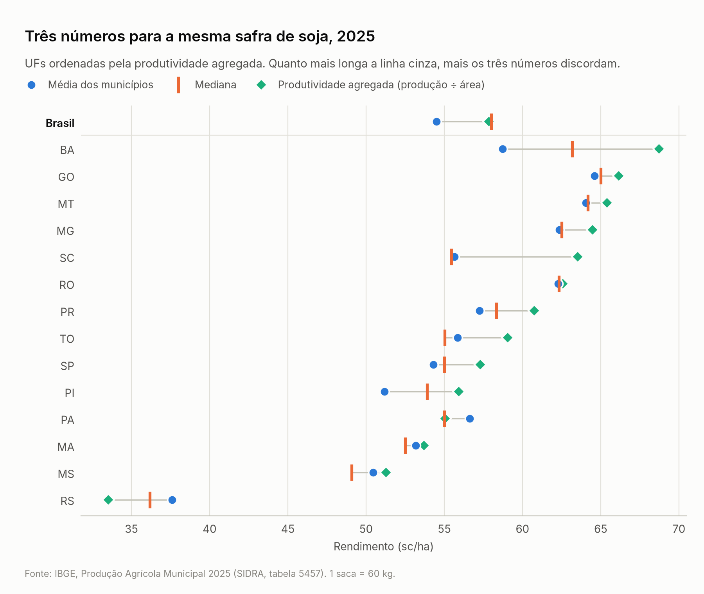
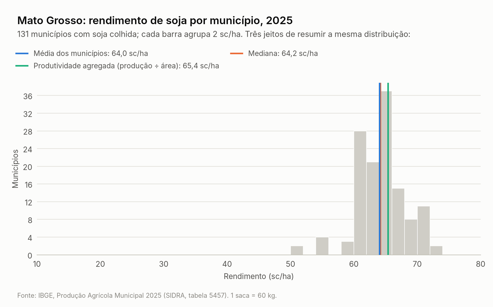
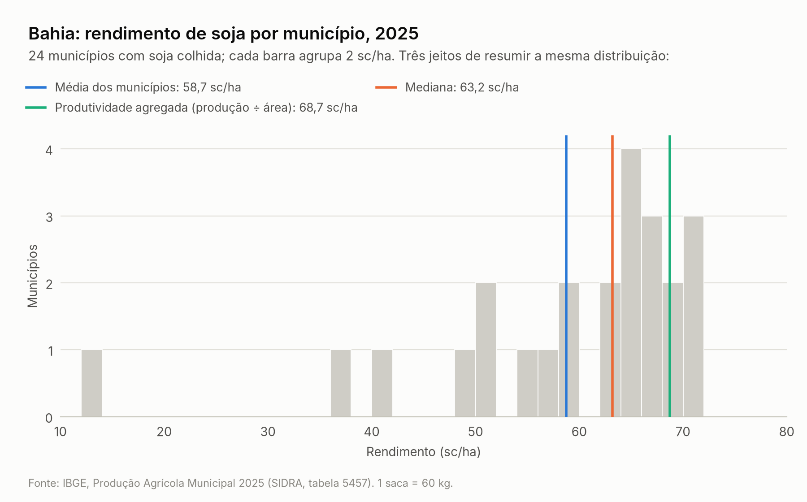
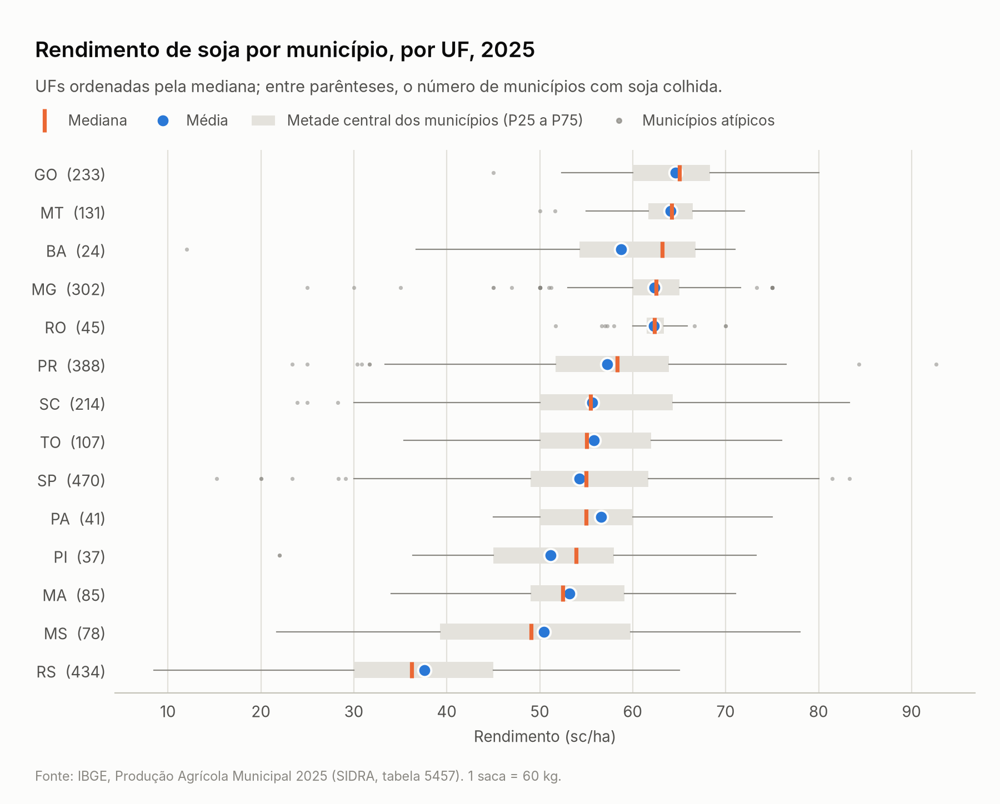

# Produtividade de soja: média vs mediana

> Média, mediana e distribuição da produtividade de soja por município com dados públicos do IBGE (PAM/SIDRA).

"A produtividade média da safra foi de X sacas por hectare." Esse número pode ser calculado de jeitos diferentes, e eles não contam a mesma história quando a distribuição dos municípios é assimétrica. Este repositório complementa um post sobre por que a "produtividade média" engana: com dado público real, mostra como média e mediana se afastam e como um histograma muda a leitura do número de destaque.

## Três números para a mesma safra

| Medida | Conta | Responde |
|---|---|---|
| **Média dos municípios** | soma dos rendimentos ÷ número de municípios | quanto rende um município qualquer, todos com o mesmo peso |
| **Mediana** | o valor do meio | quanto rende o município típico: metade rende mais, metade menos |
| **Produtividade agregada** | produção total ÷ área colhida total | quanto a UF ou o país colheu por hectare; é a conta do número oficial |

A produtividade agregada é exatamente a média dos municípios **ponderada pela área colhida**. A diferença entre ela e a média simples vem só do peso: na média simples, um município com 50 ha vale o mesmo que um com 500 mil ha.

## Resultados (PAM 2025, safra 2024/25)

**Brasil, 2.641 municípios com soja colhida:** média dos municípios **54,5 sc/ha**, mediana **58,0 sc/ha** e produtividade agregada **57,8 sc/ha**. A média simples fica cerca de 6% abaixo das outras duas.



- **Mato Grosso:** os três números quase coincidem (64,0, 64,2 e 65,4 sc/ha). Distribuição concentrada, sem cauda relevante: qualquer um dos três serve de resumo.
- **Bahia:** média 58,7, mediana 63,2 e agregada 68,7 sc/ha. Sete municípios do oeste baiano concentram 97% da área e rendem entre 62 e 71 sc/ha; um punhado de municípios pequenos, com 12 a 50 sc/ha, derruba a média simples.
- **Rio Grande do Sul:** a ordem se inverte. Agregada 33,5, mediana 36,2 e média 37,6 sc/ha: na safra de estiagem[^rs], os municípios com mais área renderam menos (correlação de Spearman entre área e rendimento de −0,28).
- **Peso dos pequenos:** 457 municípios (17% do total) colheram menos de 500 ha e somam 0,2% da área, mas na média simples pesam como os grandes.

O histograma mostra por quê. Em Mato Grosso, a distribuição é estreita e as três linhas se sobrepõem:



Na Bahia, a grande produtora com maior diferença entre média e mediana, a cauda de municípios pequenos e de baixo rendimento puxa a média para a esquerda, enquanto a agregada acompanha os grandes produtores do oeste:





### Tabela por UF

UFs com pelo menos 20 municípios com soja colhida (99,4% da produção do país), em sc/ha. Em negrito, as diferenças entre média e mediana acima de 5%.

| UF | Municípios | Média | Mediana | P25 a P75 | Agregada | Média × mediana | Média × agregada |
|---|---:|---:|---:|---:|---:|---:|---:|
| MT | 131 | 64,0 | 64,2 | 61,7 a 66,5 | 65,4 | −0,2% | −2,1% |
| PR | 388 | 57,2 | 58,3 | 51,7 a 63,9 | 60,8 | −1,9% | −5,8% |
| GO | 233 | 64,6 | 65,0 | 60,0 a 68,3 | 66,1 | −0,6% | −2,3% |
| RS | 434 | 37,6 | 36,2 | 30,0 a 45,0 | 33,5 | +3,9% | +12,1% |
| MS | 78 | 50,4 | 49,1 | 39,2 a 59,8 | 51,3 | +2,8% | −1,6% |
| MG | 302 | 62,3 | 62,5 | 60,0 a 65,0 | 64,5 | −0,2% | −3,3% |
| BA | 24 | 58,7 | 63,2 | 54,2 a 66,8 | 68,7 | **−7,1%** | −14,5% |
| TO | 107 | 55,8 | 55,0 | 50,0 a 62,0 | 59,1 | +1,5% | −5,4% |
| SP | 470 | 54,3 | 55,0 | 49,0 a 61,7 | 57,3 | −1,3% | −5,3% |
| MA | 85 | 53,2 | 52,5 | 49,0 a 59,1 | 53,7 | +1,3% | −1,0% |
| PA | 41 | 56,6 | 55,0 | 50,0 a 60,0 | 55,0 | +2,9% | +2,9% |
| PI | 37 | 51,2 | 53,9 | 45,0 a 58,0 | 55,9 | **−5,1%** | −8,5% |
| SC | 214 | 55,7 | 55,5 | 50,0 a 64,3 | 63,5 | +0,4% | −12,4% |
| RO | 45 | 62,3 | 62,3 | 61,5 a 63,3 | 62,6 | −0,1% | −0,5% |
| **Brasil** | 2.641 | 54,5 | 58,0 | 47,5 a 64,0 | 57,8 | **−6,0%** | −5,8% |

A tabela completa, com todas as UFs, quartis, assimetria e média ponderada, está em [`data/processed/resumo_uf_2025.csv`](data/processed/resumo_uf_2025.csv).

### Experimento: sem os 5% extremos

Recalculamos média e mediana de cada UF sem os municípios acima do percentil 95 da própria UF (os ~5% de maior rendimento) e, depois, sem os ~5% abaixo do percentil 5. Na linha "Brasil", o corte é feito no país inteiro.

- Sem os 5% de **maior** rendimento, a média se moveu mais que a mediana em 11 das 14 UFs. No Brasil, a média caiu 1,0 sc/ha e a mediana, 1,3.
- Sem os 5% de **menor** rendimento, a média se moveu mais em 10 das 14 UFs. No Brasil, a média subiu 1,5 sc/ha e a mediana, só 0,3.
- Em 2025, quem distorce a média do país é a **cauda de baixo**: os 5% piores municípios (101 dos 120 no RS) rendem, em média, 31 sc/ha abaixo da média geral; os 5% melhores, só 19 sc/ha acima.

A mediana não é imune a cortes (tirar 5% de um lado sempre a desloca um pouco, porque o meio muda de lugar), mas não depende de *quão* extremos são os municípios retirados. A média se move na proporção dessa distância.

<details>
<summary>Variação por UF (sc/ha)</summary>

| UF | Sem os 5% de maior rendimento: removidos | Δ média | Δ mediana | Sem os 5% de menor rendimento: removidos | Δ média | Δ mediana |
|---|---:|---:|---:|---:|---:|---:|
| MT | 6 | −0,35 | −0,17 | 6 | +0,49 | +0,50 |
| PR | 20 | −0,98 | −0,48 | 13 | +0,89 | 0,00 |
| GO | 12 | −0,62 | −0,83 | 12 | +0,66 | +1,00 |
| RS | 11 | −0,68 | −0,18 | 20 | +1,07 | +0,82 |
| MS | 4 | −1,47 | −0,58 | 4 | +1,24 | +0,78 |
| MG | 12 | −0,46 | −0,50 | 6 | +0,50 | +0,38 |
| BA | 1 | −0,53 | −0,90 | 2 | +3,13 | +1,36 |
| TO | 5 | −0,83 | −0,02 | 5 | +0,85 | +1,65 |
| SP | 16 | −0,77 | −0,33 | 24 | +1,34 | 0,00 |
| MA | 4 | −0,76 | −0,72 | 5 | +1,08 | +0,98 |
| PA | 1 | −0,46 | 0,00 | 1 | +0,29 | 0,00 |
| PI | 2 | −1,12 | −0,55 | 2 | +1,67 | +0,10 |
| SC | 11 | −1,05 | −0,45 | 9 | +1,10 | +1,22 |
| RO | 3 | −0,47 | −0,01 | 3 | +0,51 | +0,04 |
| **Brasil** | 132 | −1,02 | −1,33 | 120 | +1,49 | +0,33 |

</details>

## Dados

- **Fonte:** IBGE, Produção Agrícola Municipal (PAM), [tabela 5457 do SIDRA](https://sidra.ibge.gov.br/tabela/5457).
- **Ano:** 2025, o mais recente publicado (para a soja, a safra 2024/25). Consulta feita em 20/11/2026.
- **Produto e nível:** Soja (em grão), todos os municípios.
- **Variáveis:** área colhida (ha), quantidade produzida (t) e rendimento médio da produção (kg/ha).

Consulta exata na API do SIDRA:

```
https://apisidra.ibge.gov.br/values/t/5457/n6/all/v/216,214,112/p/2025/c782/40124
```

| Trecho | Significado |
|---|---|
| `t/5457` | tabela 5457 (lavouras temporárias e permanentes) |
| `n6/all` | nível territorial 6 = município; todos |
| `v/216,214,112` | área colhida, quantidade produzida, rendimento médio |
| `p/2025` | ano (sem `--ano`, o script usa `last 1`, o mais recente) |
| `c782/40124` | classificação "Produto das lavouras": Soja (em grão) |

A resposta traz 5.564 municípios; 2.641 têm soja colhida. Os sinais do IBGE que não são números (`-` zero absoluto, `...` não disponível, `..` não se aplica, `X` sigiloso) viram nulo, e saem os municípios sem área colhida. Total em 2025: 47,6 milhões de ha e 165,3 milhões de t.

| Arquivo | Conteúdo |
|---|---|
| `data/raw/pam_5457_soja_municipios_2025.csv` | registros como vieram da API, sem alteração (chaves `NC`, `NN`, `MC`, `MN`, `V`, `D1C`…`D4N`; `D1N` = "Município - UF", `D2C` = variável, `V` = valor) |
| `data/processed/soja_municipios_2025.csv` | uma linha por município com soja colhida (esquema abaixo) |
| `data/processed/resumo_uf_2025.csv` | métricas por UF e Brasil, gerado pelo notebook |

Esquema de `data/processed/soja_municipios_<ano>.csv`:

| Coluna | Tipo | Descrição |
|---|---|---|
| `cod_municipio` | str | código IBGE do município (7 dígitos) |
| `municipio` | str | nome do município |
| `uf` | str | sigla da UF |
| `ano` | int | ano da PAM |
| `area_colhida_ha` | float | área colhida (ha) |
| `producao_t` | float | quantidade produzida (t) |
| `rendimento_kg_ha` | float | rendimento médio publicado (kg/ha) |
| `rendimento_sc_ha` | float | `rendimento_kg_ha / 60` (sacas de 60 kg por ha) |

**Alternativa offline:** `src/simular.py` gera municípios fictícios com rendimento assimétrico (mistura de normais), no mesmo esquema. Os dados simulados são identificados como tal: arquivo `soja_municipios_simulado.csv`, UFs `SIM-A`, `SIM-B` e `SIM-C` e municípios "Município simulado 001" etc.

## Como rodar

Python 3.11+.

```bash
pip install -r requirements.txt
python src/coleta_sidra.py        # baixa a PAM mais recente (ou --ano 2025)
python src/simular.py             # alternativa sem API: dados simulados
jupyter notebook notebooks/01_media_vs_mediana.ipynb
pytest                            # testes de src/
```

`python src/coleta_sidra.py --json resposta.json` processa uma resposta da API salva antes, sem baixar de novo. Para usar os dados simulados no notebook, troque `ARQUIVO` na célula de configuração; os gráficos vão para `img/simulado/` e não sobrescrevem os reais.

## Estrutura

```
produtividade-soja-media-vs-mediana/
├── data/
│   ├── raw/          # resposta da API do SIDRA em CSV, sem alteração
│   └── processed/    # tabela limpa por município + resumo por UF
├── notebooks/
│   └── 01_media_vs_mediana.ipynb
├── src/
│   ├── coleta_sidra.py   # baixa e limpa a PAM
│   ├── simular.py        # municípios fictícios (alternativa offline)
│   ├── metricas.py       # média, mediana, quartis, ponderada, agregada, experimento
│   └── graficos.py       # histograma, boxplot e comparação por UF
├── tests/
├── img/              # gráficos gerados pelo notebook
├── requirements.txt
├── LICENSE
└── README.md
```

## Limitações

- O rendimento municipal da PAM é uma estimativa do IBGE a partir de informantes locais, não a medição de cada lavoura, e vem arredondado: 47% dos municípios têm rendimento em sacas inteiras, o que cria empates e faz mediana e quartis caírem em números redondos.
- É um ano só. Em 2025, a estiagem no Rio Grande do Sul domina a cauda de baixo do país; em outros anos a forma da distribuição pode ser outra.
- Municípios com pouca área têm rendimento mais instável, e na média simples e na mediana pesam como os grandes. Nenhuma das três medidas é "a certa": cada uma responde uma pergunta.

## Próximos passos

- Série histórica: a tabela 5457 vai de 1974 a 2025. A cauda de baixo é sempre a mesma região? Como a diferença entre média e mediana evolui?
- Comparar com as estimativas da Conab por UF.
- Mapa do rendimento por município.

## Licença

Código sob licença [MIT](LICENSE). Dados: IBGE, Produção Agrícola Municipal; cite a fonte ao reutilizar.

[^rs]: Sobre a estiagem no Rio Grande do Sul na safra 2024/25, ver, por exemplo, [Revista Cultivar: "RS Safra 2024/25: soja tem quebra de 38% na produtividade"](https://revistacultivar.com.br/noticias/rs-safra-2024-25-soja-tem-quebra-de-38-na-produtividade).
